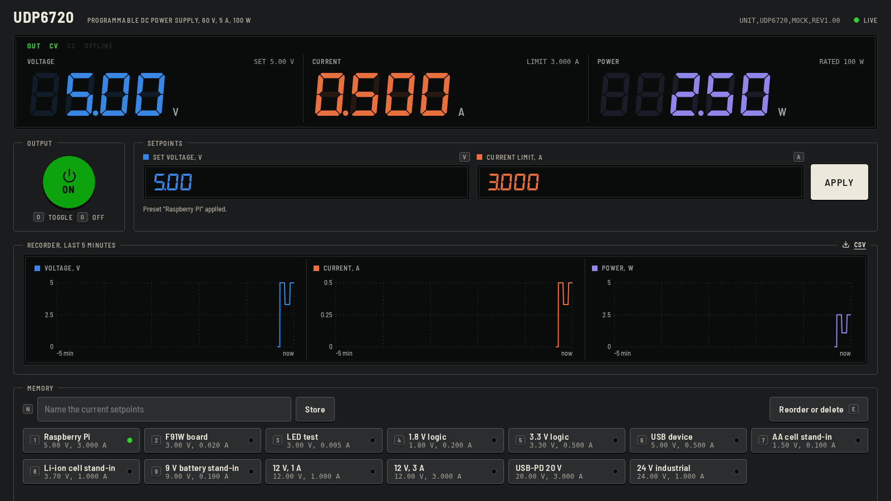

# udp6720

A web dashboard to control and monitor a UNI-T UDP6720 bench power supply
(60 V, 5 A, 100 W) over its RS232 port.



## Why

UNI-T ships a native control application for this supply, for Windows only.
There is nothing for Linux, and as far as I can tell nothing for macOS either.
My bench computer is a Raspberry Pi 5, so the supply's remote control port was
useless to me.

This project fills that gap. It is a small Python server that talks to the
supply over a serial port and serves a page to a browser, so it runs on
anything that has Python and a serial port, and the page can be used from any
device on the same network.

## Status

| Platform | State |
|---|---|
| Linux (Raspberry Pi OS, 64-bit) | The target, developed here |
| Other Linux | Expected to work |
| macOS | Untested, should work, the port is named like `/dev/cu.usbserial-XXXX` |
| Windows | Untested, should work with a `COM` port, but UNI-T's own software exists there |

The UDP6721 and UDP6722 share the same programming manual and will probably
answer the same commands, but the limits in this tool are fixed at 60 V and
5 A.

## What it does

- Live voltage, current and power, with the device's setpoints beside them
- OUT, CV and CC annunciators, CC lights up when the supply is current limiting
- Output on and off, turning on always asks for confirmation
- Voltage and current limit setpoints, each write is read back from the device
  and refused if it does not match
- Soft limits, so a slip of the finger cannot ask for 60 V
- Presets ("memory" keys) that you can create, label, reorder and delete
- A five minute recorder for voltage, current and power, with a CSV download of
  the last 30 minutes
- Keyboard shortcuts for everything
- Starts without the supply, and connects on its own when the supply is
  switched on or the USB adapter is plugged back in

## Hardware

- The UDP6720 has a DB9 RS232 port on the back.
- Use a USB to RS232 adapter with real RS232 levels (FTDI or genuine Prolific).
  It appears as `/dev/ttyUSB0`.
- Your user needs to be in the `dialout` group:
  `sudo usermod -aG dialout $USER`, then log out and in again.

## Install

Requires Python 3.11 or newer and [uv](https://docs.astral.sh/uv/).

```sh
make install
```

This creates `.venv` with the exact dependency versions from `uv.lock`.

## Run

```sh
make mock    # simulated supply, no hardware needed
make run     # real supply on /dev/ttyUSB0, baud rate detected automatically
```

Then open <http://localhost:6720>, or <http://udp6720.localhost:6720>.

Extra flags go through `ARGS`:

```sh
make run ARGS="--port /dev/ttyUSB1 --baud 9600 --max-volts 30 --max-amps 2 --safe-start"
```

| Flag | Default | Meaning |
|---|---|---|
| `--port` | `/dev/ttyUSB0` | Serial port |
| `--baud` | `auto` | Baud rate, `auto` tries each rate with `*IDN?` |
| `--mock` | off | Use the simulated supply |
| `--host` | `127.0.0.1` | Bind address, `0.0.0.0` serves the whole network |
| `--http-port` | `6720` | Port of the web page, the model number, chosen to stay clear of commonly used ports |
| `--poll-hz` | `2` | Readings per second, 0.1 to 10 |
| `--max-volts` | `60` | Soft voltage limit |
| `--max-amps` | `5` | Soft current limit |
| `--safe-start` | off | Force the output off the first time the supply answers |
| `--off-on-exit` | off | Force the output off when the dashboard stops |
| `--allow-host` | none | Extra DNS name the page may be opened under |

The same settings can live in `~/.config/udp6720/config.toml`, using
underscores. A flag overrides the file. Unknown keys and values of the wrong
type are reported at startup.

```toml
port = "/dev/ttyUSB0"
baud = 9600
max_volts = 30.0
max_amps = 2.0
safe_start = true
```

## Start at boot

On the machine wired to the supply:

```sh
make service          # install and start a systemd service, asks for sudo
make service-remove   # stop and remove it
./service.sh status
./service.sh logs
```

The dashboard is then at **<http://udp6720.local>**, on that machine only, with
no port to remember and nothing to configure.

`make service` does three things:

- installs a systemd service that runs the dashboard as your own user,
- starts it on port 80, the default web port, which that service is allowed to
  use,
- adds `127.0.0.1 udp6720.local` to `/etc/hosts`, so the name points at the
  machine itself.

`make service-remove` undoes all three.

The supply does not need to be on. The dashboard starts anyway, shows OFFLINE,
and connects when the supply answers. If you switch the supply off later it goes
back to OFFLINE and reconnects when the supply returns, without changing the
output state.

To change how the service runs, pass flags, they replace the default port:

```sh
make service ARGS="--http-port 6720"                 # if port 80 is taken
make service ARGS="--http-port 80 --host 0.0.0.0"    # reachable from other devices, no login!
```

Other settings still come from `~/.config/udp6720/config.toml`. From another
device the address is `http://<hostname>.local`, the `udp6720.local` name only
exists on the machine itself.

## Keyboard shortcuts

| Key | Action |
|---|---|
| `O` | Toggle the output, turning on asks first and `Enter` confirms |
| `0` | Output off immediately |
| `V` | Edit the voltage setpoint |
| `A` | Edit the current limit |
| `Enter` | Apply the setpoints |
| `Esc` | Cancel the edit |
| `1` to `9` | Apply that preset, the output goes off |
| `N` | Name and store the current setpoints as a preset |
| `E` | Switch preset editing on or off (store, reorder, delete) |
| `←` `→` | Move the selected preset while editing |
| `?` | Show this list on the page |

## Presets

Presets are stored in `~/.config/udp6720/presets.json`, so every browser sees
the same list. A starter set is written on the first run. After that the file
is only changed by what you do on the page.

Applying a preset always turns the output off first, and only writes the
preset's setpoints once the supply confirms the output is off. The output then
stays off until you turn it on again yourself, with `O` or the output button
on the page, which asks for confirmation as usual. If the supply does not confirm,
the preset is not applied.

## Safety

- Starting the dashboard never changes the output state, unless you pass
  `--safe-start`.
- The output is never switched on implicitly.
- Every setpoint write is followed by a readback from the device.
- If the supply or the server stops answering, the display dims, the OFFLINE
  annunciator lights and the controls are disabled, so stale readings cannot be
  mistaken for live ones.
- The 100 W power envelope is left to the supply itself, this tool only checks
  the 60 V and 5 A limits.

## Security

**There is no login.** Anyone who can reach the page can switch the output.

The dashboard binds to `127.0.0.1` by default, so only the machine it runs on
can use it. Pass `--host 0.0.0.0` only on a network you trust.

## Development

```sh
make            # list the commands
make test       # run the tests against the simulated supply
make lint       # check style and formatting
make format     # reformat
make upgrade    # move uv.lock to newer dependency versions
```

## Licence

MIT, see [LICENSE](LICENSE).

The vendored files in `udp6720/static/` keep their own licences: htm
(Apache-2.0) with Preact (MIT), and the DSEG and Barlow Semi Condensed fonts
(SIL Open Font License 1.1, texts in `udp6720/static/fonts/`).
